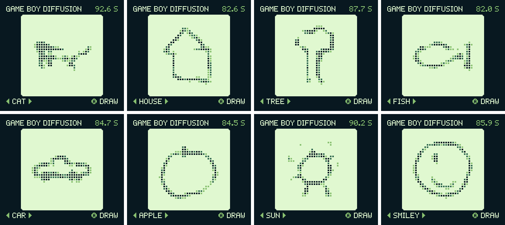

# Game Boy Diffusion

A diffusion model that runs on a real Game Boy Color. You pick a category, press A, and the handheld's own CPU draws a 28x28 doodle from random noise in 16 steps. There is no PC or streaming involved, and one drawing takes about 85 seconds.

As far as I can find this is the first diffusion model on a Game Boy. If you know of an earlier one, please tell me.

**Project page and video:** https://mowelan.github.io/gb-diffusion/



## Try it

Download [`docs/gb-diffusion-28x28.gbc`](docs/gb-diffusion-28x28.gbc) and run it in a Game Boy Color emulator or on a flash cart. It needs a 2 MB MBC5 cart. It only runs on a Game Boy Color, because it uses double speed mode and the extra WRAM banks.

Left and right pick the category, A draws. The categories are cat, house, tree, fish, car, apple, sun and smiley.

## The model

- Data: Google's [Quick, Draw!](https://github.com/googlecreativelab/quickdraw-dataset) dataset (CC BY 4.0), 110k drawings for each of the 8 classes, so 880k in total, at the native 28x28 size. None of the drawings are in the ROM.
- Network: a plain MLP, 784 → 512 → 512 → 784 with ReLU, about 1.08M parameters. It predicts the clean image x0.
- Sampling: 16 fixed DDIM steps on a cosine schedule. Class and timestep are learned bias tables on layer 1.
- Guidance: classifier-free guidance is distilled into the weights with a separate strength per class, so each step is one forward pass.

## Making it fit

- Weights are int8, activations are 4-bit, the image state is int8 at a scale of 1/32 and all sums stay in 16 bits. With 784 inputs, layer 1 is stored one bit coarser so that its sums still fit.
- Quantization-aware training uses straight-through estimators and does the same integer math as the ROM. Half of each batch comes from the model's own quantized rollouts.
- The CPU has no multiply instruction. At boot the ROM builds a 24 KB product table in WRAM banks 1 to 6, so each multiply-add is two lookups and a 16-bit add, 18 machine cycles in total. Inputs that are zero are skipped.
- One drawing takes about 8.8 million multiply-adds.

## Results

These numbers come from a classifier trained on real drawings, on a scale where lower is better (FID against 2000 real test drawings per class):

| Model | FID, scaled down to 16x16 | Recognized | Time per drawing |
|---|---|---|---|
| 16x16, 384 neurons | 41.5 | 98.5% | 23 to 27 s |
| 28x28, 384 neurons | 85.6 | 90.6% | not built |
| 28x28, 512 neurons (this ROM) | 62.5 | 94.8% | 82 to 92 s |

The 28x28 lines are smoother, but apples sometimes stay open and fish sometimes break up. The limit is the size of the network: a large U-Net scored FID 14 at 16x16 on the Mac, but it doesn't fit on the Game Boy, and as a teacher it made the small student worse.

The times come from the PyBoy emulator. On camera on my own Game Boy Color, five drawings took 81.6 to 86.8 seconds.

## Build it yourself

You need [RGBDS](https://rgbds.gbdev.io/) and Python with `torch`, `numpy`, `pillow` and `pyboy`.

```bash
cd training
GB_S=28 GB_H=512 GB_W1X=1 GB_MODEL=gb_28x28_512.pt python export.py
cd ../rom && make
cd ../training
GB_S=28 GB_H=512 GB_W1X=1 GB_MODEL=gb_28x28_512.pt python test_rom.py 0 1 2 3 4 5 6 7
```

`export.py` turns the trained model in `training/model/` into ROM data, and the result is byte-identical to the ROM in `docs/`. `test_rom.py` runs the ROM in PyBoy and compares the state after every step with the Python reference in `gbref.py`.

To retrain, put the Quick, Draw! numpy bitmaps in `training/data/`, then run `prep2.py 28`, `train_big.py` and `qat.py`. Files in `training/` start from a 16x16 default, so set the `GB_` variables as above.

## How it was made

I built this with [Claude Code](https://claude.com/claude-code): the training, the Game Boy assembly, the emulator tests and the flashing. I steered and tested.
